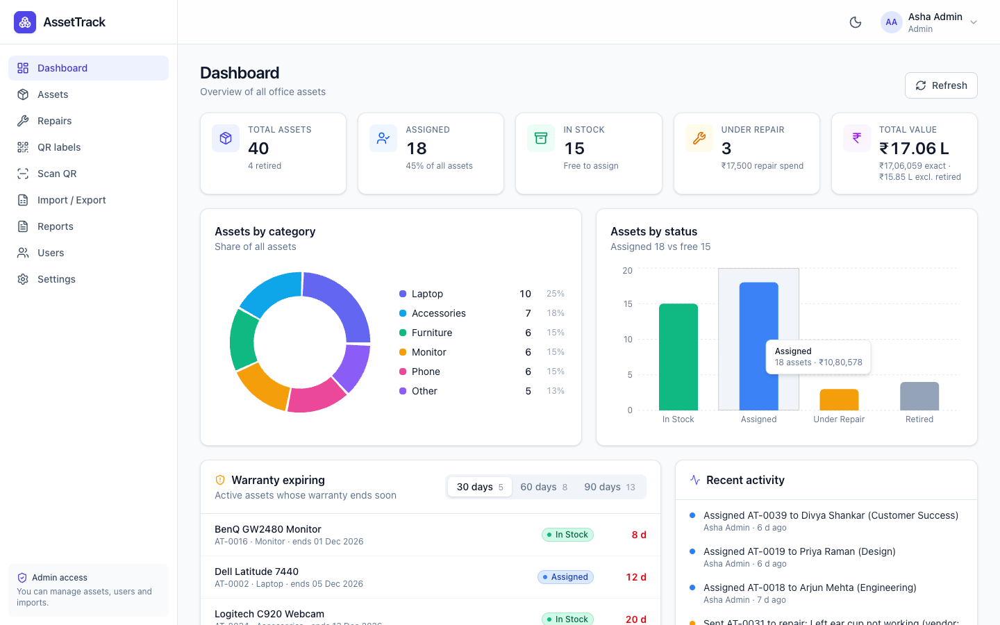
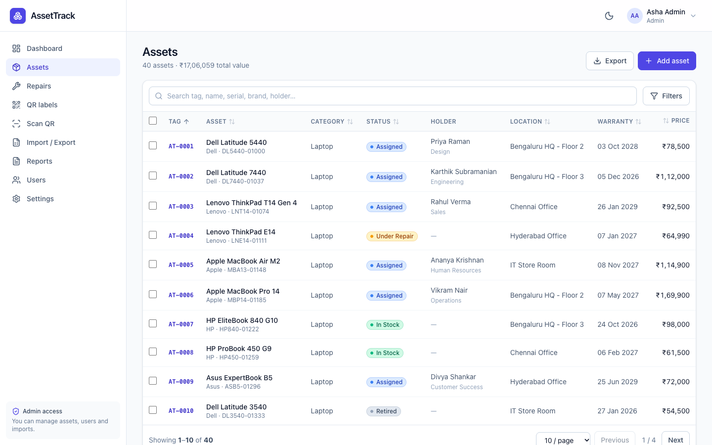
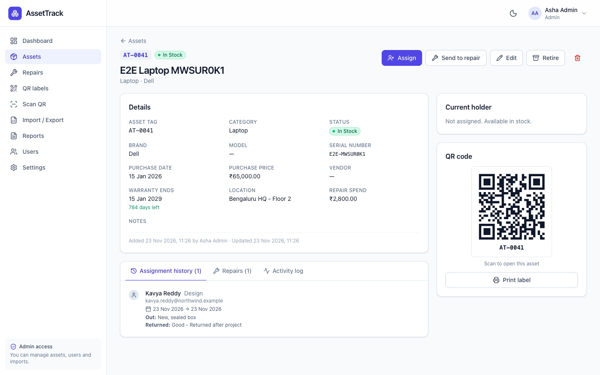
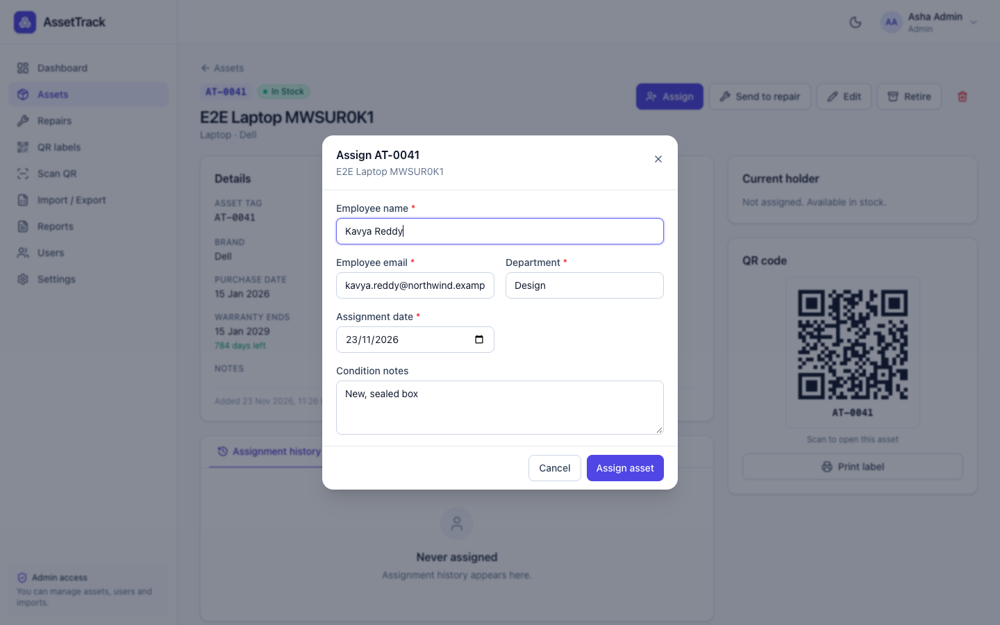
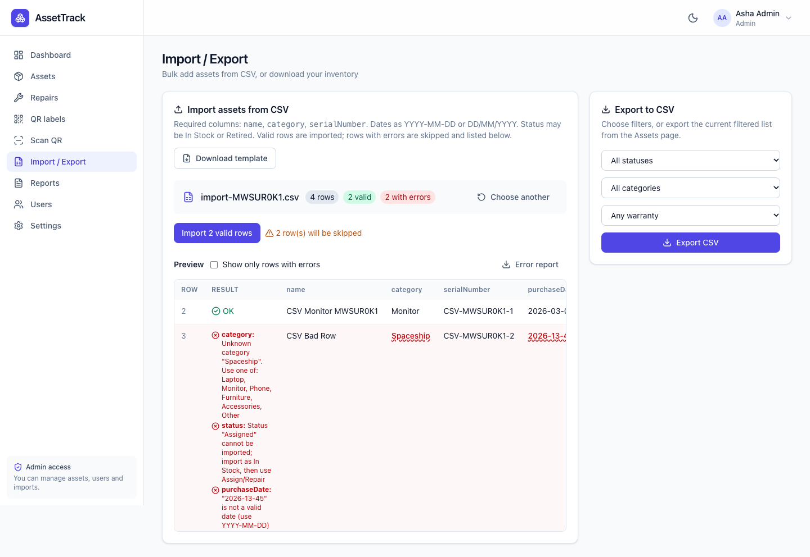
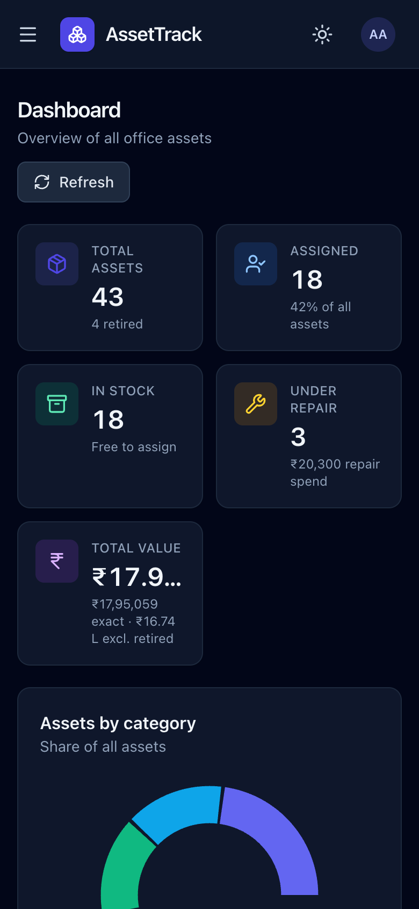

# AssetTrack

**Office asset and inventory tracker.** Know who has every laptop, monitor, phone and chair, when warranties expire, and what repairs cost.

AssetTrack is a full-stack web app: a React frontend and an Express REST API with JWT auth, role-based access (Admin / Viewer), assignment and repair workflows, QR labels with camera scanning, CSV import/export and printable PDF reports.

| | |
| --- | --- |
| **Live site** | **https://assettrack-99iv.onrender.com** |
| **Health check** | https://assettrack-99iv.onrender.com/api/health |
| **Repository** | https://github.com/DIVYAPRIYADHARSHINI-GIT/assettrack |

### Demo logins

| Role | Email | Password |
| --- | --- | --- |
| Admin (full access) | `admin@assettrack.com` | `Admin@123` |
| Viewer (read-only) | `viewer@assettrack.com` | `Viewer@123` |

The login page also has one-click buttons that fill these in.

## Screenshots

| Dashboard | Assets list |
| --- | --- |
|  |  |
| **Asset detail with QR** | **Assign dialog** |
|  |  |
| **CSV import with row errors** | **Mobile, dark mode** |
|  |  |

More in [`reports/screenshots/`](reports/screenshots/) and the [final report](reports/AssetTrack_Final_Report.pdf).

## Features

- **Auth and roles:** JWT login with expiry, logout (token revoked), current user, change password (signs out other sessions), bcrypt hashing, login rate limit. **Admin** can do everything; **Viewer** is read-only. Edit actions are hidden in the UI *and* rejected by the API with 403.
- **Assets:** auto-generated tags (`AT-0001`), unique serial numbers (case-insensitive), category, brand/model, purchase date/price, vendor, warranty end, location, status (In Stock, Assigned, Under Repair, Retired), notes.
- **Assets list:** search (tag, name, serial, brand, vendor, location, current holder), filters (category, status, location, warranty 30/60/90 days, expired, none), sortable columns, pagination, status badges, bulk select, export selected or filtered list, QR labels for the selection.
- **Assignments:** assign to an employee (name, email, department, date, condition notes); only *In Stock* assets can be assigned; return flow with date and condition; full history timeline per asset.
- **Repairs:** log issue, vendor, cost, start date and status. Starting a repair sets the asset to *Under Repair*; closing it (end date, final cost) returns it to *In Stock*. Cost totals on the Repairs page.
- **Lifecycle guards:** retire and reactivate (with confirm dialogs); delete is blocked while an asset is assigned or under repair; status can only change through these actions, so history stays consistent.
- **Dashboard:** KPI cards (total, assigned, in stock, under repair, total value), donut chart by category, bar chart by status, warranty-expiry list with 30/60/90-day tabs, recent activity feed.
- **Activity log:** every create, update (with changed fields), assign, return, repair start/close, retire, delete and import, with user and time.
- **QR codes:** every asset page shows a QR that encodes `<site>/scan/AT-0001`. The **QR labels** page builds a printable A4 sheet (24 labels: QR, tag and name) and downloads it as a PDF. The **Scan** page reads QR codes from the device camera (or an uploaded photo, or a typed tag) and opens the asset. Public endpoint `GET /api/qr/:tag` returns non-sensitive details only.
- **CSV import/export:** downloadable template; upload shows a preview with per-row, per-field errors (unknown category, bad date or price, duplicate serial in the file or the database, non-importable status); valid rows are imported and bad rows skipped; downloadable error report. Export honours the same filters as the list. Formula-injection-safe.
- **Reports:** assets by category, assigned list, warranty expiry (30/60/90 days), repair cost summary. Print, or download as a PDF.
- **Users (admin):** add, edit, change role, deactivate/reactivate; you can never remove the last active admin or deactivate yourself.
- **UI/UX:** sidebar and top bar with user menu, responsive down to 360 px (mobile cards and drawer), light/dark mode with no flash, loading skeletons, empty and error states, toasts, confirm dialogs for destructive actions, "Waking up the server, please wait…" notice on cold starts.
- **Security:** helmet with a strict Content-Security-Policy, CORS restricted to the app's own origin plus `CORS_ORIGIN`, zod validation on every input, centralized JSON error handler with proper status codes, general and login rate limits.

## Tech stack

| Layer | Tools |
| --- | --- |
| Frontend | React 19, Vite 8, Tailwind CSS 4, React Router 7, Recharts, lucide-react, sonner (toasts), `qrcode`, `jsqr`, jsPDF + jspdf-autotable |
| Backend | Node.js 20+, Express 5, Prisma 6, zod, jsonwebtoken, bcryptjs, helmet, cors, express-rate-limit, multer, csv-parse / csv-stringify |
| Database | SQLite (one file, migrated and seeded automatically on start) |
| Tests | `node:test` + supertest (18 API tests); puppeteer-core in installed Chrome (36 browser acceptance checks) |
| Hosting | Render free web service (one service serves the API and the built frontend) |

> **Database note:** the project began on PostgreSQL. At the owner's request it now uses **SQLite**, so deployment needs no database account or connection string. The Prisma models are unchanged; only the provider changed.

## Folder structure

```
assettrack/
├── backend/            Express REST API (separate npm project)
│   ├── prisma/         schema.prisma, migrations/, seed.js, data/ (SQLite file on Render)
│   ├── src/            app.js, server.js, routes/, middleware/, lib/
│   ├── scripts/test.js resets the test DB, seeds it, runs the tests
│   └── test/           API integration tests
├── frontend/           React + Vite app (separate npm project)
│   └── src/            pages/, components/, context/, api/, lib/
├── e2e/                browser acceptance suite (puppeteer-core + installed Chrome)
├── reports/            final report (PDF + MD), bug log, screenshots/, evidence/
├── render.yaml         Render Blueprint (one free web service)
└── package.json        root build/start scripts used by Render
```

## Run locally

Requirements: **Node.js 20 or newer** and npm. No database server is needed.

```bash
git clone https://github.com/DIVYAPRIYADHARSHINI-GIT/assettrack.git
cd assettrack

# 1. Backend: http://localhost:4000
cd backend
cp .env.example .env          # then set JWT_SECRET to any long random string
npm install
npx prisma migrate deploy     # creates prisma/dev.db
npm run seed                  # admin, viewer, 6 categories, 40 assets with history
npm run dev

# 2. Frontend: http://localhost:5173 (in a second terminal)
cd frontend
cp .env.example .env          # VITE_API_URL=http://localhost:4000
npm install
npm run dev
```

Open http://localhost:5173 and sign in with a demo account.

**Run it as one service, the way Render does** (from the repo root):

```bash
npm run build                  # installs both projects, builds the frontend, generates Prisma
NODE_ENV=production DATABASE_URL=file:./data/assettrack.db JWT_SECRET=<long-random> PORT=4000 npm start
# open http://localhost:4000. The DB is migrated, and seeded if empty, on start.
```

**Tests**

```bash
cd backend && npm test        # 18 API tests on a throwaway SQLite DB (test.db)
cd e2e && npm install && BASE_URL=http://localhost:5173 API_URL=http://localhost:4000 node acceptance.mjs
```

`npm run seed` resets all asset data to the sample set. `npm run db:reset` recreates the database.

## Environment variables (names only)

**Backend** (`backend/.env.example`)

| Name | Purpose |
| --- | --- |
| `DATABASE_URL` | SQLite file, e.g. `file:./dev.db` (relative to `backend/prisma/`) |
| `JWT_SECRET` | Secret for signing JWTs (Render generates it) |
| `JWT_EXPIRES_IN` | Token lifetime, e.g. `8h` |
| `CORS_ORIGIN` | Extra allowed browser origins, comma separated (same-origin is always allowed) |
| `PORT` | Listen port (Render sets it) |
| `NODE_ENV` | `development` / `production` |
| `LOGIN_RATE_LIMIT` | Login attempts per IP per 15 minutes |
| `TEST_DATABASE_URL` | Throwaway DB for `npm test` |

**Frontend** (`frontend/.env.example`)

| Name | Purpose |
| --- | --- |
| `VITE_API_URL` | API base URL for local dev. Empty in production (same origin, see `frontend/.env.production`) |

No secrets are committed; `.env` files are git-ignored.

## Deploy on Render (free)

The repo has a [`render.yaml`](render.yaml) Blueprint: **one free web service** that builds the frontend, serves it from Express, and creates, migrates and seeds the SQLite database on start. No database account, connection string, API key or payment details are needed.

1. Sign in at https://dashboard.render.com (the free plan with GitHub sign-in works; no card).
2. Click **New +** -> **Blueprint**.
3. Connect GitHub if asked, and pick the repository **DIVYAPRIYADHARSHINI-GIT/assettrack**.
4. Keep **Branch** = `main` and **Blueprint Path** = `render.yaml`. Give the Blueprint a name (e.g. `assettrack`) and click **Apply** / **Deploy Blueprint**.
5. Render creates the `assettrack` web service on the **Free** plan and generates `JWT_SECRET` itself. There is nothing to type in.
6. Wait for the deploy to show **Live** (the first build takes about 3–5 minutes). Copy the URL at the top of the service page, e.g. `https://assettrack-xxxx.onrender.com`.
7. Check `https://<your-url>/api/health`: it should return `{"status":"ok","database":"ok",...}`. Then open the URL and sign in.

Settings created by the Blueprint: build `npm run build`, start `npm start`, health check `/api/health`, env `NODE_ENV`, `NODE_VERSION`, `DATABASE_URL`, `JWT_SECRET` (generated), `JWT_EXPIRES_IN`, `LOGIN_RATE_LIMIT`, `CORS_ORIGIN`. Every push to `main` redeploys automatically.

## API summary

All routes are under `/api`. Responses are JSON: `{ data, meta? }` on success, `{ error: { message, details? } }` on failure.

| Method | Path | Access |
| --- | --- | --- |
| GET | `/health` | Public |
| POST | `/auth/login` | Public (rate limited) |
| POST | `/auth/logout` | Signed in |
| GET | `/auth/me` | Signed in |
| POST | `/auth/change-password` | Signed in |
| GET / POST | `/users` | Admin |
| GET / PATCH / DELETE | `/users/:id` | Admin (DELETE = deactivate) |
| GET | `/categories` | Signed in |
| POST / PATCH / DELETE | `/categories`, `/categories/:id` | Admin |
| GET | `/assets` (search, categoryId, status, location, warranty, ids, sortBy, order, page, pageSize) | Signed in |
| GET | `/assets/locations`, `/assets/by-tag/:tag`, `/assets/:id` | Signed in |
| GET | `/assets/:id/assignments`, `/assets/:id/repairs`, `/assets/:id/activity` | Signed in |
| POST | `/assets` | Admin |
| PATCH / DELETE | `/assets/:id` | Admin |
| POST | `/assets/:id/assign`, `/assets/:id/return` | Admin |
| POST | `/assets/:id/retire`, `/assets/:id/reactivate` | Admin |
| GET | `/repairs`, `/repairs/:id` | Signed in |
| POST | `/repairs` (start), `/repairs/:id/close` | Admin |
| PATCH | `/repairs/:id` | Admin |
| GET | `/dashboard` | Signed in |
| GET | `/activity` | Signed in |
| GET | `/csv/template`, `/csv/export` | Signed in |
| POST | `/csv/import` (`?dryRun=true` for preview) | Admin |
| GET | `/reports/summary?warrantyDays=30\|60\|90` | Signed in |
| GET | `/qr/:tag` | Public (non-sensitive fields only) |

## Known limitations

- **Free Render instance resets data.** The free plan has no persistent disk, so the SQLite file is recreated from the seed data whenever the service restarts, redeploys or wakes from sleep. Fine for a demo; for real use add a Render persistent disk (paid) or switch the Prisma provider back to PostgreSQL.
- Free instances sleep after about 15 minutes idle; the first request can take up to a minute (the login page shows a notice).
- The camera scanner needs HTTPS (or localhost) and camera permission; the photo-upload and typed-tag fallbacks work everywhere.
- Money is shown in INR; there is no multi-currency support.

Built by **Divya Priyadharshini**. Version 1.0.0.
