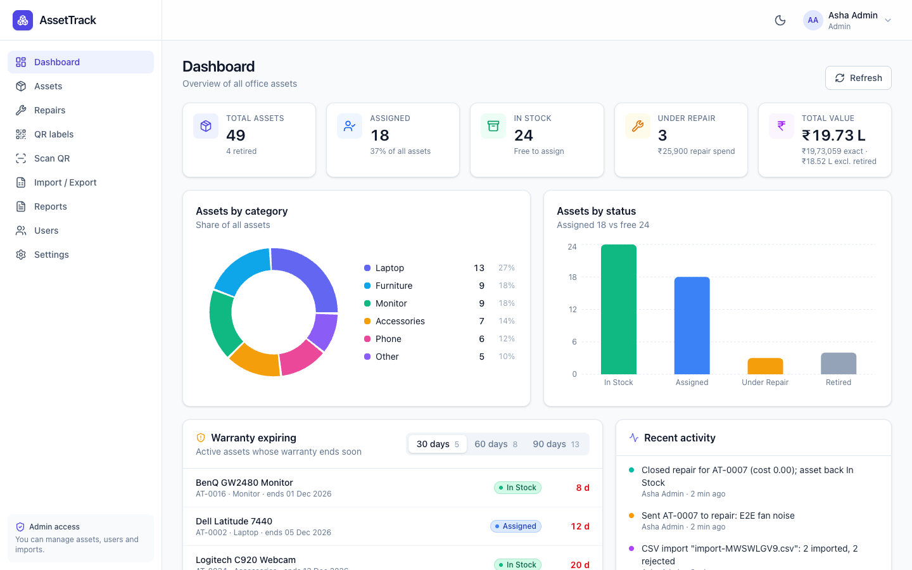
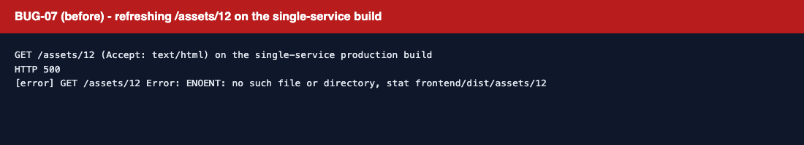
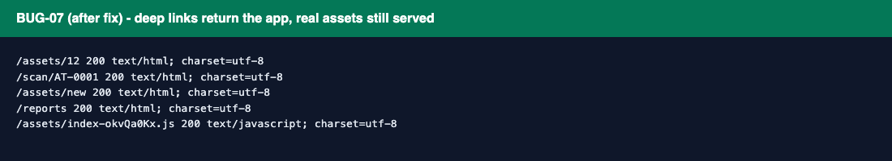
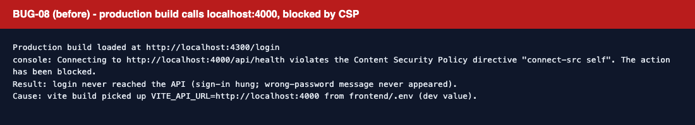
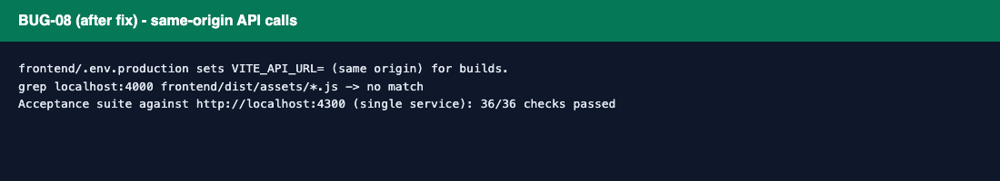

# AssetTrack: What's New

**Current version compared with the previous version**

| | Previous version | Current version |
| --- | --- | --- |
| Git commit | `4d3b9dd` | `b2e9976` |
| Date | 23 Nov 2026, 11:28 IST (first push to GitHub) | 23 Nov 2026, 12:22 IST |
| Live site | None | https://assettrack-99iv.onrender.com |
| Prepared by | Divya Priyadharshini | |

> **In short:** the app looks and works the same for users. It has the same pages, the same 40 API endpoints, the same roles and the same workflows. The new work is about getting it **live**: a database that needs no account, one service with one URL, one-click deployment, security settings for serving the website, two high-severity fixes found while preparing the deploy, and full documentation and reports.

## 1. At a glance

| Area | Previous version | Current version |
| --- | --- | --- |
| **Live site** | Not deployed | **Live on Render** at https://assettrack-99iv.onrender.com |
| **Database** | PostgreSQL; needs a Neon account and a connection string (`DATABASE_URL` + `DIRECT_URL`) | **SQLite** file; created, migrated and seeded automatically on first start. No account and no connection string |
| **App layout** | Two separate apps: a static frontend host plus a backend API | **One service, one URL**: Express serves the API and the built website |
| **Deployment** | Manual, across several dashboards, typing env vars by hand | **One-click Render Blueprint** (`render.yaml`); `JWT_SECRET` is generated by Render |
| **Start-up** | `node src/server.js` (database set up separately) | Migrates, seeds only if empty, then starts |
| **Security headers** | helmet defaults (the API served JSON only) | Content-Security-Policy configured for the website it now serves |
| **CORS** | Only origins listed in `CORS_ORIGIN` | The site's own origin is always allowed, plus `CORS_ORIGIN` |
| **Backend env vars** | 9 (incl. `DIRECT_URL`) | 8 (`DIRECT_URL` no longer needed) |
| **Docs** | No README | Full README (features, run, deploy, env vars, API) |
| **Reports** | None in the repo | Final report (PDF + MD), bug log, 66 screenshots, API evidence |
| **Testing** | 36 browser checks locally | Same 36 checks also on the production build, a fresh GitHub clone and the **live site**; failures save screenshots automatically |

## 2. New in this version

### 2.1 Live deployment

- The app is live at **https://assettrack-99iv.onrender.com** on Render's free plan.
- Health check: https://assettrack-99iv.onrender.com/api/health returns `{"status":"ok","database":"ok"}`.
- Demo logins: `admin@assettrack.com` / `Admin@123` (Admin) and `viewer@assettrack.com` / `Viewer@123` (Viewer).
- All 36 browser acceptance checks pass on the live site.

<figure class="shot"><figcaption>Live site: dashboard on https://assettrack-99iv.onrender.com</figcaption></figure>

### 2.2 SQLite database with automatic setup

- Switched the Prisma provider from PostgreSQL to SQLite, so no database account, connection string or secret is needed.
- On every start the server runs the migrations, adds the sample data **only if the database is empty**, and then starts. A restart never wipes existing data on its own.
- The tables, fields and relations are unchanged. Only PostgreSQL-only column types (`@db.Date`, `@db.Decimal(12,2)`) were removed, because SQLite does not support them. The API still returns dates as `YYYY-MM-DD` and money as numbers.
- New helper `backend/src/lib/ci.js` keeps case-insensitive checks working on SQLite: duplicate serial numbers (`dl5440-01000` vs `DL5440-01000`), duplicate category names, and serial checks during CSV import.

### 2.3 One service, one URL

- The Express backend now also serves the built React website, so the API and the website share one address and one Render service.
- Links such as `/assets/12` or a scanned `/scan/AT-0001` load the app directly, including on refresh.
- Unknown `/api/...` paths still return a JSON 404 rather than the web page.
- Caching: built files with hashed names are cached for a year; `index.html` is always re-checked, so new deploys show up immediately.
- The website calls the API on its own address (`frontend/.env.production`), so no API URL has to be configured.

### 2.4 One-click Render Blueprint

- New `render.yaml` defines one free web service: build `npm run build`, start `npm start`, health check `/api/health`, and auto-deploy on every push to `main`.
- Render generates `JWT_SECRET` automatically; the other settings are filled in by the file.
- New root `package.json` scripts: `npm run build` installs both projects, builds the website and prepares Prisma; `npm start` runs the server.

### 2.5 Security settings for serving the website

- Previously the backend only returned JSON. Now that it serves the website, its Content-Security-Policy is set up for the app:
    - scripts only from the site itself, plus the exact hash of the small theme script, computed at start-up;
    - images allow `data:`/`blob:` (QR codes);
    - camera preview allows `blob:` media.
- CORS always allows the site's own address, and still accepts extra origins from `CORS_ORIGIN`.

### 2.6 Documentation and reports

- **README.md:** description, features, screenshots, live link, demo logins, local run steps, one-service run, Render steps, env var names and an API summary.
- **Final report:** `reports/AssetTrack_Final_Report.pdf` (38 pages) and its `.md` copy. It covers requirements vs built, the API list, database design, test results, the bug log with before/after screenshots, local and live screenshots, deployment details and limitations.
- **Bug log:** `reports/BUG_LOG.md` lists 8 bugs with steps, expected vs actual, severity and fix.
- **Screenshots and evidence:** 66 screenshots and the raw API transcripts for the API-only bugs.

### 2.7 Testing improvements

- The same 36-check browser suite now also runs against:
    - the one-service production build;
    - a fresh clone from GitHub, built exactly as Render builds it;
    - the live site.
- When a check fails, the suite now saves a screenshot of every open browser tab at that moment.
- The 18 API tests were re-run on SQLite: 18 / 18 pass.

## 3. Bugs fixed in this version

Two high-severity bugs appeared when the app was turned into one service. Both were fixed before deploying. (BUG-01 to BUG-06 were already fixed in the previous version.)

### BUG-07 (High): refreshing an asset page returned an error

Opening `/assets/12` directly (a refresh, a shared link or a scanned QR code) returned HTTP 500. The app's `/assets/...` pages share a prefix with the website's built-files folder, and a missing file was treated as an error instead of loading the app. Now built files are served normally and every other `/assets/...` address loads the app.

<figure><figcaption>Before</figcaption></figure><figure><figcaption>After fix</figcaption></figure>

### BUG-08 (High): the production build called the local test server

The built website still pointed at `http://localhost:4000`, and the new security policy blocked it, so sign-in would have failed on the live site. Production builds now call the API on their own address.

<figure><figcaption>Before</figcaption></figure><figure><figcaption>After fix</figcaption></figure>

## 4. What did not change

- All 12 pages: Login, Dashboard, Assets, Asset detail, Add/Edit, Repairs, QR labels, Scan, Import/Export, Reports, Users and Settings.
- All 40 API endpoints, the Admin and Viewer roles, and the 403 blocking of viewer changes.
- The asset, assignment, repair, retire, CSV and QR workflows, the activity log, and the dashboard numbers.
- The UI: light/dark mode, mobile layout, skeletons, toasts and confirm dialogs.
- The sample data: 2 users, 6 categories and 40 assets with history.

## 5. Trade-offs to be aware of

- **Live data resets on the free plan.** Render's free instance has no permanent disk, so the SQLite file returns to the sample data whenever the service restarts, redeploys or wakes from sleep. The previous PostgreSQL design would have kept data, but needed a Neon account.
- **Differs from the original brief.** The brief asked for Neon PostgreSQL and a separate static frontend host. This version uses SQLite and one service, as you requested, to avoid API keys and accounts.
- **Getting persistent data back:** either add a Render disk (paid) or switch the Prisma provider back to PostgreSQL. The data model was first built and tested on PostgreSQL.

## 6. Verification

| Check | Previous version | Current version |
| --- | --- | --- |
| API tests | 18 / 18 (PostgreSQL) | 18 / 18 (SQLite) |
| Browser checks, local dev | 36 / 36 | 36 / 36 |
| Browser checks, fresh clone | 36 / 36 | 36 / 36 (cloned from GitHub, built like Render) |
| Browser checks, one-service production build | Not applicable | 36 / 36 |
| Browser checks, live site | Not deployed | **36 / 36** |

---

*AssetTrack · What's New · prepared by Divya Priyadharshini · 23 November 2026*
